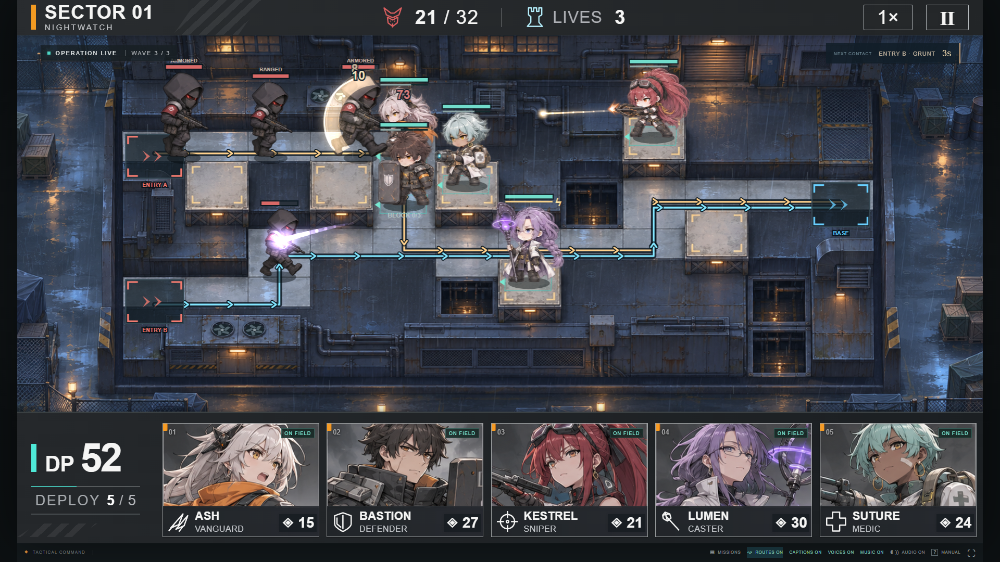

<div align="center">

# Astra

**A tactical tower-defense game with five operators, three battlefields, and a line worth holding.**

[**Play Now →**](https://astra-iota-mocha.vercel.app/)




</div>

---

## Overview

Start with an empty battlefield. Spend deployment points to place your squad, choose their facing, and stop enemies from reaching the blue defense points. Placement, armor, block capacity, healing coverage, and skill timing all matter.

Astra runs in the browser with React and Canvas 2D. Art, music, effects, and Japanese operator dialogue are bundled with the game. There is no account system or gameplay backend.

## Features

- Five operators with distinct roles, directional ranges, and active skills
- Three missions with different routes, enemy formations, bosses, and hazards
- Chibi character animation, weapon effects, and visible block counters
- Flowing molten metal, rising embers, rain, snow, steam vents, and ventilation fans
- Tactical pause, two-speed combat, retreat, and redeployment
- Instrumental music, combat sound effects, Japanese dialogue, and English captions
- Saved mission ratings and a mission-select screen with assault forecasts
- Desktop and landscape mobile play

## Operators

| Operator | Role | Specialty |
| --- | --- | --- |
| Ash | Vanguard | Blocks 2; generates extra DP with her skill |
| Bastion | Defender | Blocks 3; heals himself and reduces damage with Iron Fortress |
| Kestrel | Sniper | Long-range bolts and a five-target salvo |
| Lumen | Caster | Armor-piercing splash damage and a slowing nova |
| Suture | Medic | Heals injured allies within her selected range |

## Missions

| Operation | Hostiles | Tactical focus |
| --- | ---: | --- |
| Nightwatch | 32 | Two approaches merge at a shared bend |
| Pale Sanctuary | 36 | Opposing entries, whiteouts, and frost pulses |
| Cinder Works | 40 | Two exits, armored escorts, and timed furnace vents |

Turn **Routes** on to see each enemy approach. Visible service walkways can be scenery; enemies follow the marked routes. Raised platforms are deployment positions for ranged operators, not enemy roads.

## Controls

| Input | Action |
| --- | --- |
| Mouse / touch | Select an operator, select a tile, choose a facing, and confirm |
| **1–5** | Select an operator |
| **W A S D** / **Arrow keys** | Set facing during placement |
| **Enter** | Confirm placement |
| **Q** | Activate the selected operator’s charged skill |
| **Space** | Pause / resume |
| **Escape** | Cancel placement or selection; otherwise pause |
| Toolbar | Toggle routes, captions, voices, music, sound, or fullscreen |

### Deployment and blocking

Selection slows combat to quarter speed. Gold tiles show attack range; mint tiles show healing range. Ground operators use roads, while ranged operators and medics deploy directly onto raised platforms.

Normal enemies consume 1 block, armored enemies 2, and bosses 3. Enemies that exceed an operator’s capacity pass through; this is intentional. Use Bastion to hold bosses and support him with damage and healing.

Retreat refunds half the DP cost and starts a 25-second cooldown. Defeated operators need 35 seconds. Redeploying costs more DP. Foundry vents damage both allies and enemies.

### Mobile

Play in **landscape**. Portrait orientation pauses combat and shows a rotation prompt. Fullscreen requests orientation lock when the browser supports it.

## Run Locally

Requires **Node.js 22.13 or newer**.

```bash
npm ci
npm run dev
```

Open the local URL printed in the terminal, normally [http://127.0.0.1:5173/](http://127.0.0.1:5173/).

## Saves and Progress

Best mission ratings are saved in the browser’s `localStorage`. Three stars means no breaches, two means two lives remaining, and one means one life remaining. Stars record your best result; they do not unlock rewards.

**Resume Operation** returns to the current battle while the page remains open. Reloading starts a new session. Ratings belong to the site address and browser profile, so local and hosted saves are separate. Existing ratings remain compatible.

## How It Works

- `components/` — mission selection, briefing, HUD, roster, and result screens
- `lib/battle.mjs` — combat, deployment, blocking, skills, and projectiles
- `lib/missions.mjs` / `lib/waves.mjs` — terrain, ranges, routes, and assault schedules
- `lib/tactics.mjs` — rendering, sprite registration, controls, and effects
- `lib/environment-renderer.mjs` / `lib/weather.mjs` — scenery movement and weather particles
- `lib/audio.mjs` — music, voices, effects, and volume ducking
- `public/assets/` — artwork, audio, and asset licenses

## Testing

```bash
npm test
npm run build
```

Tests cover deployment restrictions, facing, blocking, cooldowns, healing, projectile timing, boss encounters, hazards, wins on all three missions, animation states, weather motion, and result music. Winning simulations use deliberate formations and skill timing.

## Deployment

The game is hosted on [Vercel](https://astra-iota-mocha.vercel.app/). Its existing deployment contract is retained:

- **Build command:** `npm run build:vercel`
- **Output directory:** `dist/client`

Vite produces a complete static site, including `index.html`; a server prerender step is no longer needed. To host it elsewhere, serve `dist/client` as a static website.

```bash
npm run build:vercel
npm run preview
```

## Credits and Licenses

Music by **Scott Buckley** and **FiftySounds**. Sound effects include work by **Kenney**, **Will Leamon**, and **ViRiX Dreamcore**. Japanese voice libraries are credited to **VOICEVOX** and their respective creators.

See [asset credits](./CREDITS.md) for attribution and license links. Preserve the bundled credits and license files when redistributing the game or its assets.
